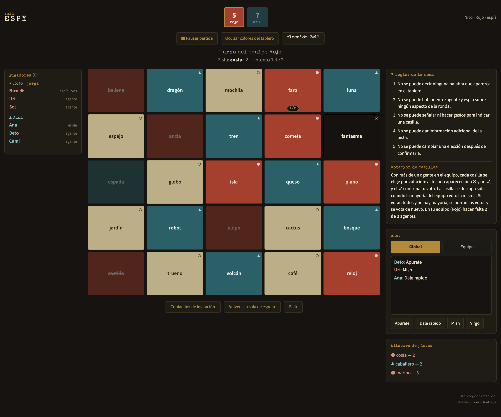

# Código Secreto

Codenames online y en castellano, para jugar con amigos cada uno desde su pantalla.

**👉 Jugá acá: https://tareas-fondeanas.nicocukier.workers.dev**

No hace falta cuenta ni instalar nada: alguien crea una sala, comparte el link y el resto entra.



*Así ve la partida el espía del equipo rojo. Los agentes ven las mismas palabras, pero sin los colores.*

## Cómo se juega

- Se arman equipos. Cada uno tiene un **espía** (el líder) y uno o más **agentes** (los miembros).
- En el tablero hay palabras de cada equipo, casillas **neutrales** y **bombas**. Solo los espías
  saben de quién es cada una.
- En su turno, el espía da una pista de **una sola palabra** y un número. «Playa 3» quiere decir
  «hay tres palabras de nuestro equipo que tienen que ver con playa».
- Los agentes eligen casillas. El número de la pista es la cantidad de intentos.
- Gana el equipo que descubre todas sus palabras. El que toca una bomba queda afuera.

La pista no puede ser una palabra del tablero, y durante la partida no se puede hacer señas ni
dar información de más: las reglas completas están en el juego.

## Qué tiene

- **De 2 a 4 equipos** (rojo, azul, amarillo y verde). Con más equipos, el tablero crece.
- **Modificadores** que elige quien crea la sala:
  - cuántas bombas hay;
  - si tocar una casilla neutral o del rival corta el turno o no;
  - reloj para el espía y para los agentes;
  - si el color de cada casilla se ve al instante o recién al terminar el turno.
- **Votación** cuando hay varios agentes en un equipo: una casilla se elige cuando la vota la mayoría.
- **Chat global** con mensajes rápidos, y **chat de equipo** escrito solo entre agentes, sin el espía.
- **Pausa** para toda la mesa, y un botón para que el espía oculte los colores si alguien le mira la pantalla.
- **Unas 980 palabras** distintas.

## Para desarrollar

Hace falta Node 20.19 o más nuevo (lo pide Vite).

```bash
npm install
npm test            # tests de la lógica de los juegos y del servidor de salas
npm run servidor    # arma la página y levanta todo junto en http://localhost:8787
```

`npm run servidor` usa `wrangler dev`: corre el servidor de salas en tu compu, con su propia base
local, así que las salas de prueba no tocan las del sitio publicado. Para tocar la interfaz con
recarga automática, dejá `npm run servidor` corriendo y en otra terminal `npm run dev`
(http://localhost:5173): Vite le pasa `/api` al servidor local.

### Publicar

No hace falta hacer nada: **cada `git push` a `master` lo publica solo** (Cloudflare Workers Builds
corre `npm run build` y `npx wrangler deploy`). El estado de cada publicación se ve en GitHub, al
lado del commit, y en el panel de Cloudflare → Workers & Pages → tareas-fondeanas.

## Cómo está hecho

- **React 19 + Vite** para la interfaz.
- **Cloudflare Workers** sirve el sitio y el servidor de salas, en el plan gratis.
- Cada sala (código de 4 letras) es un **Durable Object**: un mini servidor con su propia base,
  al que cada pantalla se conecta por **WebSocket**. Cuando nadie juega, se duerme y no gasta.
  El cliente ([`src/realtime.js`](src/realtime.js)) tiene la misma forma que Firebase Realtime
  Database, que era lo que se usaba antes, así que los juegos casi no cambiaron.
- Toda la lógica de cada juego es un reducer puro, sin React ni red, que corre dentro de una
  transacción: si dos jugadores tocan algo al mismo tiempo, no se pisan.
- En Fútbol las jugadas van **directo entre navegadores** (WebRTC); el servidor solo presenta a
  las pantallas y hace de respaldo.

El detalle de la arquitectura, las decisiones de diseño y las cosas que ya dieron problemas está
en [`CLAUDE.md`](CLAUDE.md).

## Autores

Hecho por **Nicolas Cukier** y **Uriel Suti**.

## Trazo Loco

Nuevo juego de dibujo y teléfono descompuesto en el menú: Normal, Imitación, Historia y Sandwich. Salas para 3 a 20 jugadores con editor táctil, cadenas privadas, revelación y álbumes.

La estructura de datos, la privacidad de las entregas y las pruebas están en [docs/GARTIC.md](docs/GARTIC.md).
